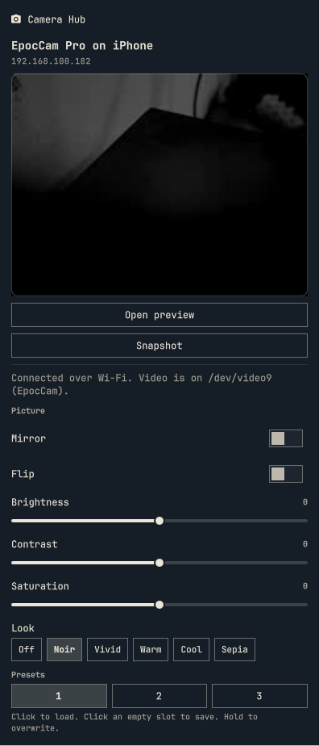

# Camera Hub for Omarchy

Elgato camera controls in your Omarchy bar, plus a trick the original app
never had on Linux: **use an iPhone as a webcam over Wi-Fi.**


|  | Looks, presets, and a live mini preview |
|---|---|
|  |  |

Plugin id: `csarmiento.elgato-camerahub` · MIT · Omarchy bar widget

> This is not Elgato software. It does not ship Camera Hub, firmware, or LUTs,
> and it never writes vendor HID reports or extension-unit packets.

## What you get

**iPhone as a camera (EpocCam over Wi-Fi)**

- The phone shows up as a normal camera called **EpocCam** (`/dev/video9`).
  Chrome, Google Meet, OBS and PipeWire apps see it like any webcam.
- Live mini preview inside the panel, and a big preview window on demand.
- Mirror, flip, brightness, contrast, saturation.
- Looks: Noir, Vivid, Warm, Cool, Sepia, plus your own `.cube` LUTs.
- Three preset slots, and a snapshot button.
- Reconnects on its own when the phone locks and comes back.

**Elgato webcams over USB**

- Facecam, Facecam Pro, Facecam 4K, Facecam MK.2, Facecam Neo: the V4L2
  controls the camera really has (auto exposure, exposure, gain, white
  balance, focus, zoom, pan/tilt, sharpness, anti-flicker, and so on).
  Switches for the auto modes, sliders and menus for the rest.
- Presets, snapshot and the big preview work here too.
- Cam Link and Game Capture are detected and left alone.

The bar label is the camera name when one device is connected, otherwise
"Camera".

## Install

```bash
omarchy plugin add https://github.com/crisesarmiento/omarchy-elgato-camerahub --enable
omarchy bar move csarmiento.elgato-camerahub --section right   # optional
```

Needs `python3`. Install what you want to use:

| For | Package |
|---|---|
| USB sliders | `v4l-utils` |
| iPhone video, looks, snapshot, big preview | `ffmpeg` (includes `ffplay`) |
| Finding the phone on your network | `avahi` (`avahi-browse`) |
| The virtual camera device | `v4l2loopback-dkms` (or the module for your kernel) |

Without `v4l-utils` the panel still lists the camera and says sliders are
unavailable.

After updating the plugin, run `omarchy restart shell` once. The shell can
keep showing the previous version of a plugin until it restarts.

## Set up the iPhone

1. Install **EpocCam** on the iPhone and open it. Keep the phone and your
   computer on the same Wi-Fi.
2. Create the virtual camera once. This needs `sudo`:

   ```bash
   sudo tee /etc/modprobe.d/v4l2loopback.conf <<'EOF'
   options v4l2loopback video_nr=9 card_label=EpocCam exclusive_caps=1
   EOF
   echo v4l2loopback | sudo tee /etc/modules-load.d/v4l2loopback.conf
   echo 'SUBSYSTEM=="video4linux", KERNEL=="video9", TAG+="uaccess"' | sudo tee /etc/udev/rules.d/99-epoccam.rules
   sudo udevadm control --reload
   sudo modprobe v4l2loopback video_nr=9 card_label=EpocCam exclusive_caps=1
   ```

   The first three lines make it survive a reboot, the last one loads it now.
3. Open the panel from the bar. The phone appears under its own name and the
   picture starts flowing. Pick **EpocCam** in Chrome, Meet, OBS, anywhere.

The plugin keeps one connection to the phone for as long as it runs. The phone
only accepts one computer at a time, so close Camera Hub on another machine.

## Using it

- **Open preview**: a big `ffplay` window for the selected camera. Click again
  to close it. Only one program can read a camera node at a time, so close it
  before starting a call.
- **Snapshot**: saves a PNG in `~/Pictures/CameraHub/`.
- **Presets**: click a saved slot to load it, click an empty one to save,
  hold a saved one to overwrite it.
- **Look**: Off, Noir, Vivid, Warm, Cool, Sepia. Put your own `.cube` files in
  `~/.config/elgato-camerahub/luts/` (names like `My-Look.cube`, letters,
  digits, `_` and `-`) and they appear as extra looks.

Picture changes restart the picture for a moment. Everything runs in ffmpeg
on your computer; nothing extra is sent to the phone.

## Troubleshooting

| Symptom | Try |
|---|---|
| Panel shows only text, no buttons | `omarchy restart shell` |
| "Missing /dev/video9" | Run the `modprobe` line from the iPhone setup |
| A PipeWire app does not list EpocCam | `systemctl --user restart wireplumber` |
| Snapshot or preview says the camera is busy | Another app is reading `/dev/video9`; close it |
| Phone not found | Same Wi-Fi? EpocCam open? Is `avahi-daemon` running? |
| Picture frozen after the phone slept | Wait a few seconds; the plugin reconnects |

Check the plugin from a terminal:

```bash
omarchy plugin validate .
python3 camerahub.py status
```

`status` prints one JSON object. With no camera, `devices` is empty.

## Limits

- The iPhone feed is 640x480 H.264. Other resolutions are listed by the phone
  but not requested yet.
- Focus, exposure, white balance, zoom and torch on the **phone** are not
  driven. Those messages were not recovered, and this plugin does not guess
  packets. Mirror, flip, color and looks are done locally instead.
- Facecam settings that live behind Elgato's vendor interface (HDR, noise
  reduction, LED, saved profiles, USB transfer mode) and firmware updates are
  not implemented on purpose.
- Capture cards (EDID, HDR-to-SDR) are detected only.
- No background blur or replacement, and no Prompter.

See [docs/protocol.md](docs/protocol.md) for what was learned about the
original app and the phone protocol, and what is still unknown.

## Devices

USB vendor `0fd9`. Product ids are the ones Camera Hub 2.3.0 (7295) ships in
its device table. USB 2.0 fallback ids are included.

| Product | USB id |
|---|---|
| Facecam | `0fd9:0078` |
| Facecam Pro | `0fd9:0079` |
| Facecam Neo | `0fd9:0081` |
| Facecam 4K | `0fd9:0092` (USB 2.0 `0091`) |
| Facecam MK.2 | `0fd9:0094` (USB 2.0 `0093`) |
| Facecam MK.2 Rev.2 | `0fd9:00d7` (USB 2.0 `00d6`) |
| Cam Link | `0fd9:0061` (USB 2.0 `0062`) |
| Cam Link 4K | `0fd9:0066` (USB 2.0 `0067`) |
| Cam Link 4K MK.2 | `0fd9:007b` (USB 2.0 `0085`) |
| Cam Link 4K Rev.3 | `0fd9:00a1` (USB 2.0 `00a2`) |
| Game Capture 4K X | `0fd9:009c` (USB 3.2 `009b`, USB 2.0 `009d`) |
| Game Capture 4K S | `0fd9:00af` (USB 2.0 `00ae`) |

## How it works

`camerahub.py` is a small helper the QML calls (`status`, `set`, `preview`,
`preset`, `snapshot`). USB controls go through `v4l2-ctl`. For the iPhone, a
background process (`hold`) logs in to the phone, subscribes to the video
stream, and pipes the H.264 into ffmpeg, which writes the v4l2loopback camera
and a tiny JPEG the panel shows as its mini preview.

## Files and state

- Plugin checkout: `~/.config/omarchy/plugins/csarmiento.elgato-camerahub/`
- State: `~/.local/state/elgato-camerahub/` (connection, picture settings, presets)
- Mini preview image: `$XDG_RUNTIME_DIR/camerahub-preview.jpg`
- Snapshots: `~/Pictures/CameraHub/`
- Your LUTs (read only): `~/.config/elgato-camerahub/luts/`

## Remove

```bash
omarchy plugin remove csarmiento.elgato-camerahub
```

Optionally delete the state folder and the three `sudo` files from the iPhone
setup (`/etc/modprobe.d/v4l2loopback.conf`, `/etc/modules-load.d/v4l2loopback.conf`,
`/etc/udev/rules.d/99-epoccam.rules`).

## License

MIT. Copyright Cristian Sarmiento, 2026. Elgato, Camera Hub, Facecam, Cam Link
and EpocCam are trademarks of their owners; this project is not affiliated
with them.
