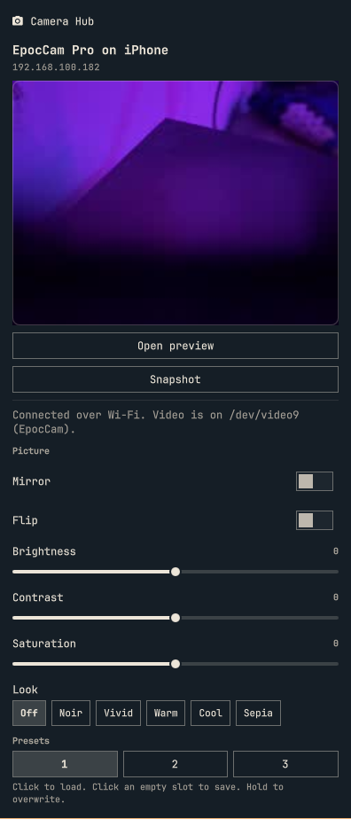

# Camera Hub

Bar widget for Elgato cameras on Omarchy. Plug in a Facecam and the panel
reads the controls Linux already exposes: exposure, gain, white balance,
focus, zoom, and the usual picture sliders.

Plugin id: `csarmiento.elgato-camerahub`.

This is not Elgato software. It does not ship Camera Hub, firmware, or LUTs.
It does not write vendor HID reports or extension-unit packets. Capture cards
(Cam Link, Game Capture) are detected and left alone.




The shots are the live panel with nothing plugged in. Sliders appear when a Facecam exposes V4L2 controls.

## Install

```bash
omarchy plugin add https://github.com/crisesarmiento/omarchy-elgato-camerahub --enable
```

Needs `python3`. Sliders need `v4l-utils` (`v4l2-ctl`). Without it the panel
still shows the camera, and says sliders are unavailable.

The widget lands on the right of the bar. Move it with:

```bash
omarchy bar move csarmiento.elgato-camerahub --section right
```

## What you get

Click the camera icon.

- No camera: a short empty state and the families this plugin recognizes.
- Facecam, Facecam Pro, Facecam 4K, Facecam MK.2, Facecam Neo: the V4L2
  controls that node actually has. Auto exposure, auto focus, and auto white
  balance are switches. The rest are sliders or menus. A change is sent as
  soon as you release the slider.
- Cam Link and Game Capture: name and USB id only. Picture, EDID, and HDR
  controls from Camera Hub are not driven.
- EpocCam on an iPhone, over Wi-Fi: the phone shows up when it advertises
  `_egstreamwrap._tcp`. The plugin logs in and stays connected, so the phone
  stops waiting for a computer. It then subscribes to the 640×480 H.264
  stream and decodes it with ffmpeg into a v4l2loopback camera at
  `/dev/video9` (card name `EpocCam`). Create the device once:
  `sudo modprobe v4l2loopback video_nr=9 card_label=EpocCam exclusive_caps=1`
  and `sudo chmod 666 /dev/video9`. Needs `ffmpeg`. The panel then offers
  mirror, flip, brightness, contrast, and saturation. These run in ffmpeg on
  your computer; nothing extra is sent to the phone. The picture restarts
  for a moment when you change one.
- Looks, presets, snapshot: on the iPhone feed the panel also has a Look menu
  (Off, Noir, Vivid, Warm, Cool, Sepia). Drop your own `.cube` files in
  `~/.config/elgato-camerahub/luts/` (names like `My-Look.cube`) and they
  appear as extra looks. Three preset slots save and load the current
  settings on the iPhone and on USB webcams. Snapshot saves a PNG to
  `~/Pictures/CameraHub/`. Elgato's own LUTs are not included.
- Preview: "Open preview" opens an `ffplay` window for the selected camera
  (click again to close it). Only one program can read `/dev/video9` at a
  time, so close the preview before opening OBS or a browser call.

The bar label is the camera name when one device is connected, otherwise "Camera".

## Devices

USB vendor `0fd9`. Product ids are the ones Camera Hub 2.3.0 (7295) ships in
its device table. USB 2.0 fallback ids are included.

| Product | USB id |
|---|---|
| Facecam | `0fd9:0078` |
| Facecam Pro | `0fd9:0079` |
| Facecam Neo | `0fd9:0081` |
| Facecam 4K | `0fd9:0092` (USB 2.0 `0091`) |
| Facecam MK.2 | `0fd9:0094` (USB 2.0 `0093`) |
| Facecam MK.2 Rev.2 | `0fd9:00d7` (USB 2.0 `00d6`) |
| Cam Link | `0fd9:0061` (USB 2.0 `0062`) |
| Cam Link 4K | `0fd9:0066` (USB 2.0 `0067`) |
| Cam Link 4K MK.2 | `0fd9:007b` (USB 2.0 `0085`) |
| Cam Link 4K Rev.3 | `0fd9:00a1` (USB 2.0 `00a2`) |
| Game Capture 4K X | `0fd9:009c` (USB 3.2 `009b`, USB 2.0 `009d`) |
| Game Capture 4K S | `0fd9:00af` (USB 2.0 `00ae`) |

## What Camera Hub does that this does not

Camera Hub 2.3.0 applies some looks in software (LUT, background, blur,
virtual camera) and talks to the Facecam over a vendor HID report and a UVC
extension unit for metering, noise reduction, LED, and profiles. Those byte
layouts were not confirmed on hardware here, so they are documented and not
sent. Firmware update is intentionally missing.

See [docs/protocol.md](docs/protocol.md).

## Check it

```bash
omarchy plugin validate .
python3 camerahub.py status
```

`status` prints one JSON object. With no camera, `devices` is empty.

## Remove

```bash
omarchy plugin remove csarmiento.elgato-camerahub
```

Nothing is written under `~/.config` except the plugin checkout Omarchy clones,
and the enabled bit in `shell.json`.

## License

MIT. Copyright Cristian Sarmiento, 2026.
